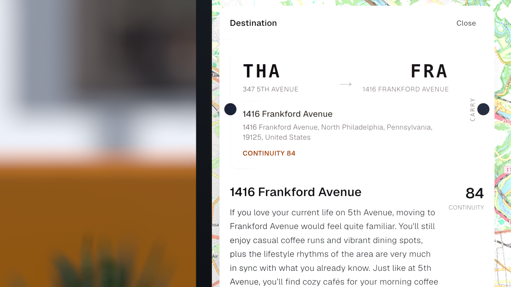
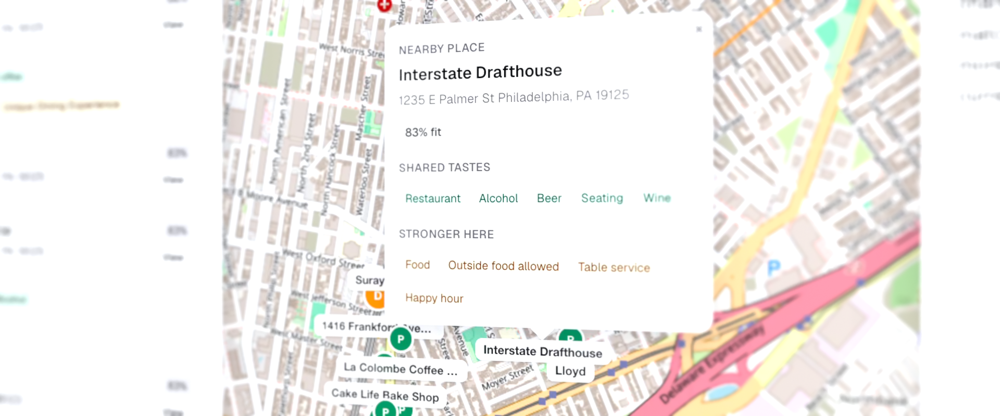
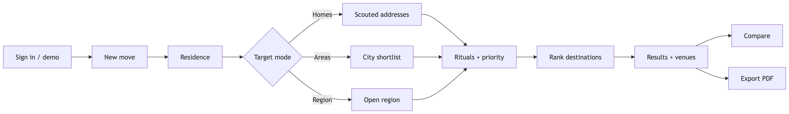
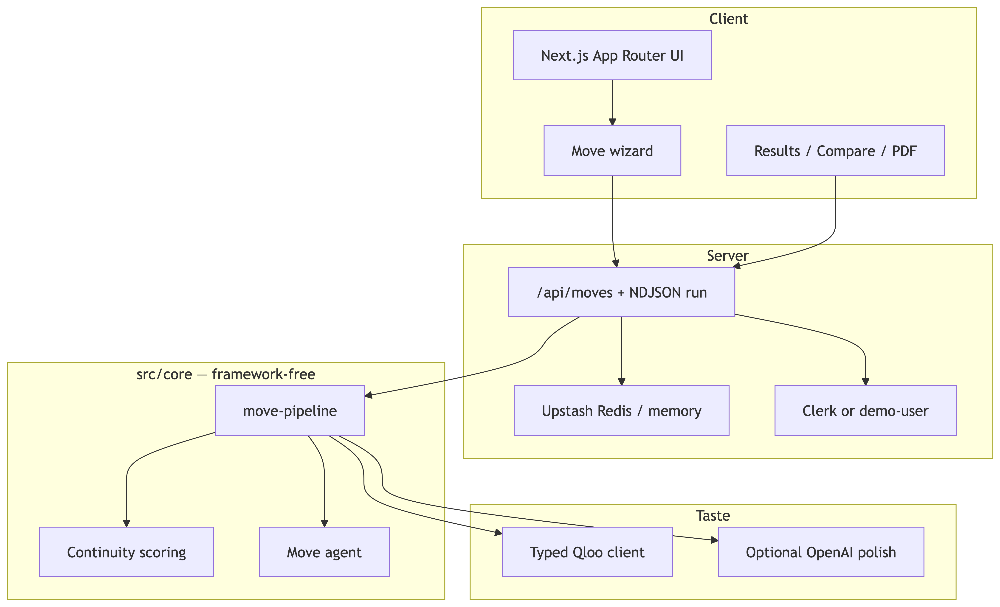
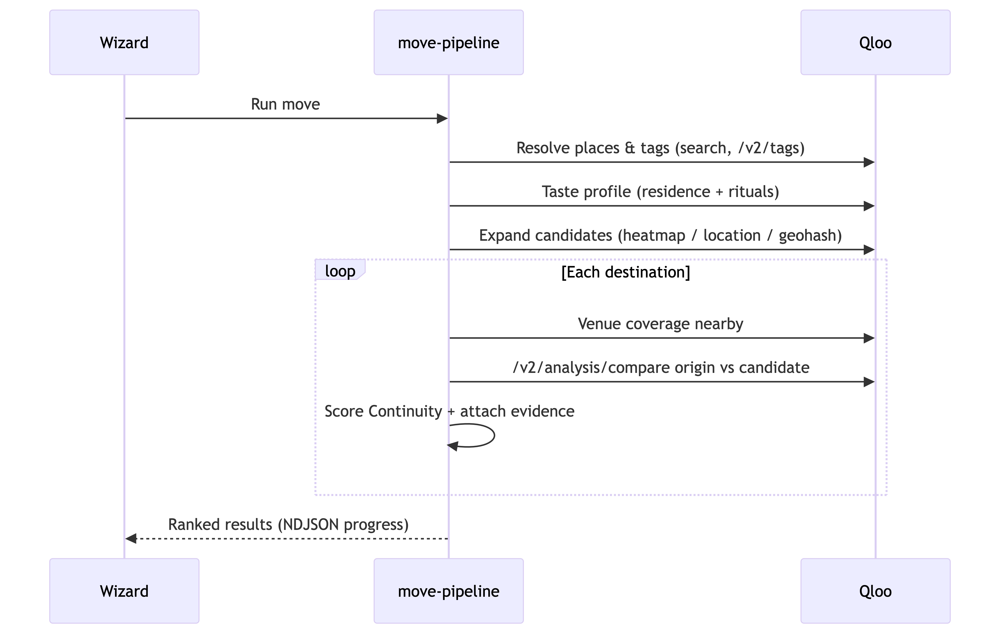

# Carry — Hackathon Submission

**Which parts of your week will still feel like yours after you move?**


---

## Inspiration

Relocation is usually decided with rent, commute, and a map pin. The harder question is whether your *week* still works after the boxes are unpacked: the café that starts your morning, the bookstore you browse on Sundays, the kind of nightlife you actually go to. Listing sites optimize logistics. City guides sell vibe. Neither measures **taste continuity**.

We treated that gap as a product problem. People mid-move already have apartments, a shortlist of cities, or only a vague region — and they need a concrete read on cultural fit before signing a lease. HR and relocation partners need a shareable brief, not another list of tourist spots.

Qloo’s taste graph made it possible to treat “will my life still feel like mine?” as something you can rank, compare, and export — geography and housing as the interface, affinity and ritual coverage as the signal. That is a non-obvious use of a cultural taste graph: destinations scored on what carries over, what breaks, and which nearby venues support the same rituals.

If the ranking would look the same without Qloo, Carry would not exist.

---

## What it does

Carry is an end-to-end relocation product grounded in cultural intelligence — not a single API demo.



1. **Sign in** (or open the app in demo mode) and start a **new move**.
2. Set your **current residence**, then choose how you’re searching:
   - **Homes** — apartments you already scouted
   - **Areas** — a shortlist of cities or neighborhoods
   - **Region** — an open brief (“somewhere in Oregon”)
3. Add **ritual places** (and optional preference tags) and pick a priority:
   - **Keep Similar** — maximize continuity with your current week
   - **Change** — prefer destinations that feel meaningfully different
   - **Balanced** — blend similarity and distance
4. **Rank destinations** with a **Continuity** score, matches / mismatches, what to expect, and supporting venues.
5. **Compare** two destinations side by side, then **export a PDF** brief for the place you’re considering.



**Continuity** is Carry’s own metric — affinity, shared tags from Qloo compare, and ritual venue coverage — with a priority bias so Keep Similar and Change read differently. It is a **taste signal**, not rent, commute, safety, or lease advice.

---

## How we built it

### Product flow



### Architecture



### Stack

| Layer | Choice |
|-------|--------|
| App | Next.js App Router |
| Auth | Clerk (optional `demo-user` fallback) |
| Domain | Framework-free `src/core` (`move-pipeline`, scoring, agents) |
| Contracts | Zod schemas shared by API and UI |
| Data | Upstash Redis (in-memory fallback) |
| Taste | Typed Qloo client with cache and retries |
| Copy / PDF | Optional OpenAI; `@react-pdf/renderer` |

### Multi-step Qloo pipeline

Rankings collapse without the taste graph. The move pipeline does non-trivial, multi-step work — not a single “places like this” call:



| Step | Qloo surface | Role |
|------|--------------|------|
| Resolve places & tags | Entity search, `/v2/tags` | Ritual places and freeform preferences → graph entities |
| Taste profile | Taste tags for residence + rituals | Origin cultural fingerprint |
| Candidate expansion | Heatmap clustering and/or location / geohash place search | Homes, areas, or a region → ranked seeds |
| Venue coverage | Places in location / geohash | Venues that could continue each ritual |
| Origin vs destination | `/v2/analysis/compare` | Shared vs unique tags |

Optional OpenAI polish turns those signals into readable summaries; without it, template copy still surfaces the same entity-backed evidence. The LLM never invents venues or tags that Qloo did not return.

---

## Challenges we ran into

- **Apartment ≠ entity.** Qloo is strong at cultural affinity around places and weak at turning a street address into a taste node. Homes mode geocodes with Photon and leans on nearby place / geohash signals instead of pretending listings are graph entities.
- **Ambiguous regions.** “Somewhere in Oregon” needed heatmap clustering and geohash seeds, with fallbacks when heat data was thin — uniqueness handling and venue filters so nearby homes didn’t collide in ranking.
- **Readable without inventing.** Raw tags are noisy. We humanize tags, filter venues for relocation relevance, and keep template summaries entity-backed when OpenAI is off.
- **Demo vs production.** Optional Clerk and Redis paths so anyone can run locally without a full infra stack, while `/app` and `/api/moves` still behave correctly when keys are present.

---

## Accomplishments that we're proud of

- A **complete product loop** — wizard → ranked results → venue evidence → compare → PDF — that judges can use end to end, not a proof-of-concept around one endpoint.
- Rankings that **depend on multi-step Qloo work** (taste profile, candidate expansion, venue coverage, compare). Continuity, venue evidence, and exported briefs all go soft if the taste graph is removed.
- Target modes that match real move situations (homes / areas / region) and priority modes that reframe the same graph signals for Keep Similar vs Change.
- A tested, framework-free core with a fake Qloo client, plus architecture and walkthrough docs so the implementation is reviewable, not just demoable.
- Honest framing: Continuity is labeled as a taste signal, with clear limits on what it is *not* (rent, commute, safety, lease advice).

---

## What we learned

- Cultural intelligence pays off when you **compose** the taste graph — profile → expand → cover → compare — instead of wrapping a single recommendation call in chat UI.
- Relocation is a sharp problem space: people already think in addresses and regions, so **entity resolution and geocoding** are half the product.
- Users need an explicit metric and disclaimers so Continuity never gets mistaken for housing advice.
- Demo ergonomics (no Clerk / no Redis / template LLM) matter as much as the happy path when someone needs to try the app in minutes.

---

## What's next for Carry

1. **Postgres + Drizzle** — durable multi-instance move storage beyond Redis
2. Richer **MapLibre** overlays for geohash candidates and venue pins on results
3. Optional **rent / commute** layers beside the cultural score (clearly labeled)
4. **Employer / HR seats** — org accounts, shared move projects, SSO
5. An **MCP server** (`create_move`, `run_move`, `get_ranking`) for agent hosts
6. Retire the legacy `/api/briefs` path once demos no longer need it

---

## Try it

```bash
cp .env.example .env
# QLOO_API_KEY required. Optional: OPENAI_*, UPSTASH_*, Clerk keys.

npm install
npm test
npm run dev
```

Open [http://localhost:3000](http://localhost:3000) → **Open app** (demo) or sign in.

MIT — see [LICENSE](../LICENSE).
